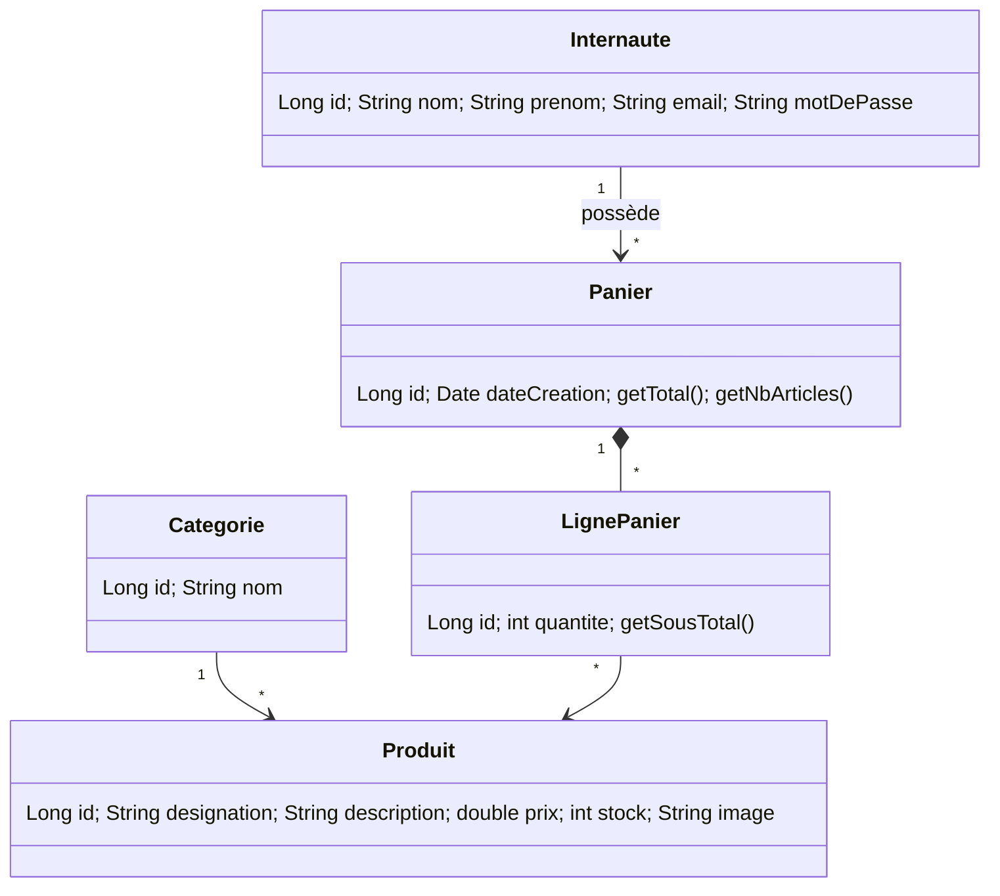

# Atelier JEE – Application web e-Commerce (MVC 2 + JPA)

Faculté des Sciences et Techniques de Tanger – Cycle LSI – Pr. Elaachak Lotfi

Site e-commerce simplifié : **vitrine**, **panier**, **internautes**, gestion des **produits**.
Contrôleur MVC 2 (une servlet par gestion, plusieurs actions via le paramètre `action`), persistance **JPA / EclipseLink** sur **MySQL**, vues **JSP + JSTL** (+ jQuery).

## Prérequis
- JDK 11+ · Maven 3.8+ · Tomcat **9** (namespace `javax.*`) · MySQL 8 (utilisateur `root`, mot de passe vide par défaut)

## Lancer
1. Démarrer MySQL. La base `ecommerce` est créée automatiquement (`createDatabaseIfNotExist=true`).
2. Adapter `src/main/resources/META-INF/persistence.xml` si besoin (user / mot de passe).
3. `mvn clean package` puis déployer `target/ecommerce.war` sur Tomcat 9 (ou dans Eclipse : *Run on Server*).
4. Ouvrir `http://localhost:8080/ecommerce/`.

Au premier démarrage, les tables sont générées par JPA et un jeu de données (3 catégories, 6 produits) est inséré par `InitDataListener`.

## Étape 1 – Diagramme de classes

Un visiteur non connecté a un panier anonyme (`internaute = null`) ; à la connexion/inscription il est rattaché à l'internaute.

## Étapes 2-3 – Maven, JPA, MySQL
- `pom.xml` : mysql-connector-java, EclipseLink 2.7.5 (apporte l'API `javax.persistence` 2.2), servlet-api / jsp-api (provided), JSTL.
  > Le sujet ajoute aussi `javax.persistence 2.0.0` : je ne l'ai pas gardé car il entre en conflit avec l'API 2.2 qu'EclipseLink 2.7.5 requiert. Le bloc `eclipselink` du sujet contient aussi des balises mal fermées (`>artifactId<`, `<dependency/>`) – corrigé.
- `META-INF/persistence.xml` : unité `ecommercePU`, `RESOURCE_LOCAL`, `eclipselink.ddl-generation=create-or-extend-tables`.
- Entités : `Internaute`, `Categorie`, `Produit`, `Panier`, `LignePanier` (relations `@ManyToOne` / `@OneToMany` avec cascade + `orphanRemoval`).
- `JPAUtil` : une seule `EntityManagerFactory` ; les DAO (`ProduitDao`, `InternauteDao`, `PanierDao`) ouvrent un `EntityManager` par opération et gèrent la transaction (begin / commit / rollback).

## Étape 4 – Contrôleurs MVC 2
| Servlet | Gestion | Actions |
|---|---|---|
| `VitrineServlet` | catalogue | `lister`, `rechercher`, `detail` |
| `ProduitServlet` | produits (admin) | `lister`, `formAjouter`, `ajouter`, `formModifier`, `modifier`, `supprimer` |
| `InternauteServlet` | internautes | `formInscription`, `inscrire`, `formLogin`, `login`, `logout`, `lister`, `supprimer` |
| `PanierServlet` | panier | `afficher`, `ajouter`, `modifier`, `retirer`, `vider` |

Les JSP sont dans `WEB-INF/jsp` (inaccessibles directement : tout passe par une servlet), écrites avec JSTL (`c:`, `fmt:`, `fn:`) ; jQuery sert au filtre instantané, à l'envoi auto de la quantité et aux confirmations de suppression. Le lien contrôleur ↔ modèle se fait par injection des DAO dans les servlets (champ `private final XxxDao`).

## Mini-rapport (à compléter avec captures d'écran)
- **Objectif** : maîtriser JPA dans une application MVC 2.
- **Conception** : diagramme ci-dessus ; panier persistant, rattachable à un internaute.
- **Réalisation** : couche modèle (entités + DAO), contrôleurs, vues.
- **Difficultés** : conflit de versions JPA (voir plus haut) ; entités détachées → relations en `EAGER` pour l'affichage JSP ; fusion du panier invité à la connexion.
- **Limites** : pas de rôles (l'admin des produits est ouvert), pas de validation de commande, mots de passe hachés en SHA-256 sans sel (usage pédagogique – préférer bcrypt).

## Mettre sur GitHub
```bash
git init && git add . && git commit -m "Atelier MVC2 + JPA"
git branch -M main
git remote add origin https://github.com/<user>/<repo>.git
git push -u origin main
```
